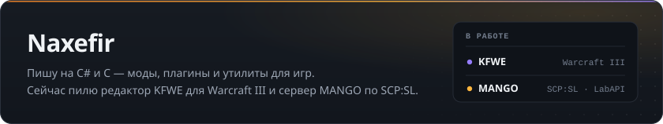
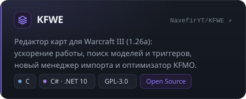
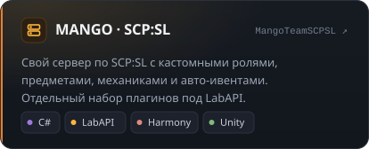
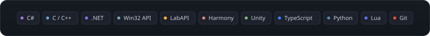

  <picture><source media="(prefers-color-scheme: dark)" srcset="assets/hero-dark.svg"><source media="(prefers-color-scheme: light)" srcset="assets/hero-light.svg"></picture>

### Проекты

  <a href="https://github.com/NaxefirYT/KFWE"><picture><source media="(prefers-color-scheme: dark)" srcset="assets/card-kfwe-dark.svg"><source media="(prefers-color-scheme: light)" srcset="assets/card-kfwe-light.svg"></picture></a>
  <a href="https://github.com/MangoTeamSCPSL"><picture><source media="(prefers-color-scheme: dark)" srcset="assets/card-mango-dark.svg"><source media="(prefers-color-scheme: light)" srcset="assets/card-mango-light.svg"></picture></a>

### Стек

  <picture><source media="(prefers-color-scheme: dark)" srcset="assets/stack-dark.svg"><source media="(prefers-color-scheme: light)" srcset="assets/stack-light.svg"></picture>

### Активность

  <picture>
    <source media="(prefers-color-scheme: dark)" srcset="https://raw.githubusercontent.com/NaxefirYT/NaxefirYT/output/github-contribution-grid-snake-dark.svg">
    <source media="(prefers-color-scheme: light)" srcset="https://raw.githubusercontent.com/NaxefirYT/NaxefirYT/output/github-contribution-grid-snake.svg">
    
  </picture>
   
  Большая часть коммитов — в приватных репозиториях.

### Контакты

  <a href="https://t.me/NaxefirMango"><picture><source media="(prefers-color-scheme: dark)" srcset="assets/btn-telegram-dark.svg"><source media="(prefers-color-scheme: light)" srcset="assets/btn-telegram-light.svg"></picture></a>&nbsp;
  <a href="https://discord.gg/3m2BtRsuUB"><picture><source media="(prefers-color-scheme: dark)" srcset="assets/btn-discord-dark.svg"><source media="(prefers-color-scheme: light)" srcset="assets/btn-discord-light.svg"></picture></a>&nbsp;
  <a href="https://www.youtube.com/@NaxefirMango"><picture><source media="(prefers-color-scheme: dark)" srcset="assets/btn-youtube-dark.svg"><source media="(prefers-color-scheme: light)" srcset="assets/btn-youtube-light.svg"></picture></a>&nbsp;
  <a href="https://www.twitch.tv/naxefiryt"><picture><source media="(prefers-color-scheme: dark)" srcset="assets/btn-twitch-dark.svg"><source media="(prefers-color-scheme: light)" srcset="assets/btn-twitch-light.svg"></picture></a>

 

  

